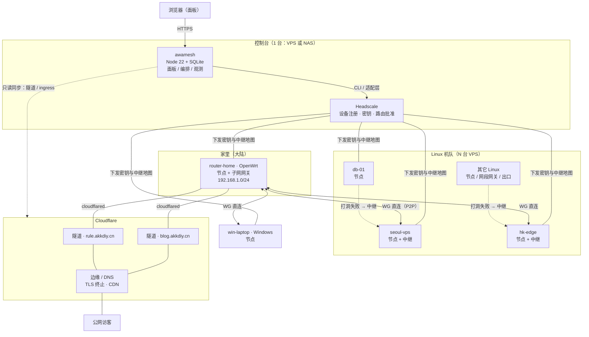

# awamesh

自托管的组网控制台：把 OpenWrt、Linux 机队和 Windows 收进一张网，顺手管住中继和 Cloudflare 隧道。

`v0.1.0` · 单容器 · 零外部依赖 · MIT

> 现状：**可运行骨架**。登录、设备/中继/隧道/事件四个页面、一次性接入脚本、演示数据都已可用；
> 接真实控制面（Headscale）的适配层已写好，尚待在真机上联调。路线见文末 Roadmap。

---

## 它解决什么

自用场景下的三个真实痛点：

1. **家里一台 OpenWrt 当 WG 服务端**，新设备加进来要手改配置、分发密钥、同步 AllowedIPs
2. **一堆 Linux VPS 有的有公网 IP、有的只能出网**，彼此访问要么靠公网端口，要么只能单向
3. **博客/面板靠一台台 cloudflared 暴露**，域名指向哪台机器、后端活没活，全靠记

awamesh 做三件事：**组网（P2P 优先 + 中继兜底）**、**中继编排**、**隧道可视化**。

---

## 快速开始

### 方式一：一条命令

```bash
curl -fsSL https://raw.githubusercontent.com/OWNER/awamesh/main/install.sh | sh
```

它会检查 Docker、生成随机密钥、写 `docker-compose.yml`、拉镜像、等健康检查，最后打印面板地址和首次口令。

### 方式二：compose

```yaml
services:
  awamesh:
    image: ghcr.io/OWNER/awamesh:latest
    container_name: awamesh
    ports: ["8080:8080"]
    environment:
      - AWA_SECRET=换成一串长随机字符
      - AWA_DATA_DIR=/data
      - AWA_BACKEND=mock          # 接真实控制面改成 headscale
    volumes: ["./data:/data"]
    mem_limit: 192m
    restart: unless-stopped
```

```bash
docker compose up -d
docker compose logs awamesh | grep 口令     # 首次启动会打印后台口令
```

### 方式三：本机跑（无 Docker）

```bash
node --version        # 需要 >= 22.5（内置 node:sqlite）
npm start             # 默认 http://127.0.0.1:8080
```

首次启动会生成 `data/initial-admin.txt` 并在终端打印口令。

---

## 界面

| 页面 | 做什么 |
|---|---|
| 概览 | 在线设备、直连占比、本月流量、隧道健康、实时事件 |
| 设备 | 列表 / 搜索 / 按状态筛选、改名、吊销、生成接入命令 |
| 中继节点 | 启用/摘除、公网或仅内网、流量与配额、健康状态 |
| Cloudflare 隧道 | 域名 → 后端映射、后端探活（v0.1 只读） |
| 事件 | 上下线、路径切换、密钥、隧道异常 |
| 设置 | 运行信息、MTU、Mesh 域名后缀 |

> 截图会随 v0.1 一起补到 `docs/screenshots/`（真实界面截取，不是设计稿）。

---

## 接入一台设备

在「设备 → 添加设备」生成一次性密钥（默认 1 小时有效），把命令贴到目标机器：

```bash
curl -fsSL 'http://<控制台地址>/join.sh?key=awa_xxx' | sh -s -- --hostname db-01
```

脚本行为（每一步都会先打印）：

1. 检测包管理器，安装 `tailscale`（apk / apt / dnf / yum）
2. 启动 `tailscaled` 并设开机自启
3. `tailscale up --login-server=<控制面> --authkey=<一次性密钥> --accept-routes --accept-dns=false`
4. 打印拿到的 Mesh IP 与 `tailscale status` 前 20 行

**OpenWrt 注意**：先 `opkg install tailscale kmod-tun`；如果路由器可用内存 < 80MB，建议把节点放到家里另一台机器，用 `--advertise-routes` 发布家里网段。

---

## 与现有 WG / CF 隧道共存

awamesh 不接管你已有的东西，只做增量：

| 现有 | 共存方式 |
|---|---|
| OpenWrt 上的 `wg0` | 保留；新增 `tailscale0` 作为第二个接口，网段不重叠即可 |
| 每台机器上的 `cloudflared` | 保留；面板只读同步，不修改 ingress |
| 公网直连的 VPS | 直接加进 mesh，同时可一键设为中继 |

迁移建议：先加 1 台测试机 → 验证互通 → 逐台接入 → 全迁完再关旧 `wg0`。任何一步都能用「吊销」回退。

---

## 配置项

| 环境变量 | 默认 | 说明 |
|---|---|---|
| `AWA_PORT` | 8080 | 面板端口 |
| `AWA_HOST` | 0.0.0.0 | 监听地址（只给本机用可设 127.0.0.1） |
| `AWA_DATA_DIR` | ./data | 数据目录（SQLite + 首次口令 + 密钥） |
| `AWA_SECRET` | 自动生成并落盘 | 会话签名与凭证存储用 |
| `AWA_BACKEND` | mock | `mock` 演示 / `headscale` 接真实控制面 |
| `AWA_HEADSCALE_CMD` | headscale | headscale 可执行文件路径 |
| `AWA_HEADSCALE_USER` | awamesh | 预授权密钥归属用户 |
| `AWA_CONTROL_URL` | 空 | 控制面地址，写进接入脚本 |
| `AWA_MESH_CIDR` | 10.88.0.0/24 | Mesh 网段 |
| `AWA_MESH_DOMAIN` | mesh | MagicDNS 后缀 |
| `AWA_MTU` | 1420 | WireGuard MTU（跨境链路可降 1280） |
| `AWA_EVENT_KEEP_DAYS` | 30 | 事件保留天数 |
| `AWA_MODE` | full | `tiny` 降低内存占用 |

---

## 架构



**三种角色，一台机器可以叠加**

| 角色 | 谁承担（示例） | 作用 |
|---|---|---|
| 节点 node | 所有设备 | 拿到 `10.88.0.x`，彼此互通 |
| 中继 relay | seoul-vps、hk-edge、家宽 | 打洞失败时转发（DERP，走 443/8443，穿墙最稳） |
| 网段网关 gateway | router-home、任意一台 Linux | `--advertise-routes` 把所在 LAN 发布进 Mesh |
| 出口 exit | 任意一台 | 作为全流量出口，客户端自选 |

**Cloudflare 在这里的三重身份**

| 身份 | 说明 |
|---|---|
| 公网发布 | 家里/机房的 `cloudflared` 出站连到 CF，把内网服务映射成域名，不需要公网 IP、不开入站 |
| DNS / TLS / CDN | 域名解析、证书、静态资源缓存都在 CF 侧 |
| 观测对象 | 控制台用只读 Token 拉隧道与 ingress 状态，和后端探活对账（在线但后端挂了会标黄） |

数据面与控制面是分开的：**流量走 WireGuard（打洞成功则不经过任何服务器），只有编排和观测经过控制台**；awamesh 自己从不转发用户流量。

## 自测

```bash
npm run selftest
```

会拉起一个临时实例（独立端口 + 临时数据目录），跑 18 项断言：鉴权、防越权、设备筛选/搜索/改名、密钥生成、接入脚本、中继开关、隧道列表、404 等，结束自动清理。

---

## Roadmap

| 版本 | 内容 |
|---|---|
| **v0.1（当前）** | 面板骨架、演示后端、接入脚本、中继开关、隧道只读 |
| v0.2 | 接入真实 Headscale、批量操作、吊销、ingress 改指与回滚、备份恢复 |
| v0.3 | Postgres 选项、MTU 调节、多子网发布、Telegram 通知 |
| 之后 | 中继流量统计、直连率分组视图、服务发布（Funnel 替代） |

---

## FAQ

**Q：和 tailscale-admin / headplane 有什么区别？**
它们只做 Headscale 的 UI。awamesh 把「中继编排 + Cloudflare 隧道 + 现有 WG 共存检查」放进同一个面板。

**Q：必须装 Headscale 吗？**
不必须。`AWA_BACKEND=mock` 可以直接跑通界面与流程；要真正组网时再切到 `headscale`。

**Q：面板能暴露到公网吗？**
可以，但建议只在内网或 mesh 内访问，前面加一层反代 + HTTPS。默认没有 TLS，面板不做公网认证的加固承诺。

**Q：会消耗我多少内存？**
控制台空载约 50–60MB（Node），中继几乎不吃 CPU 只吃带宽。`AWA_MODE=tiny` 可再降。

---

## License

MIT
