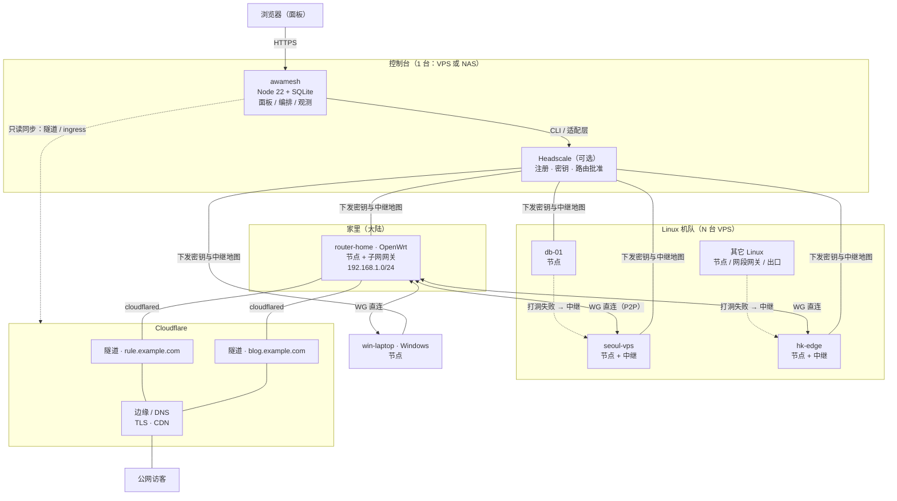

# awamesh

自托管的组网控制台：把 OpenWrt、Linux 机队和 Windows 收进一张网，顺手管住中继和 Cloudflare 隧道。

`v0.1.0` · 单容器 · 零外部依赖 · MIT · 镜像 `ghcr.io/awahello/awamesh:latest`（amd64 / arm64）

> **它不接管你现有的东西**：你 OpenWrt 上的 WireGuard、机器上的 cloudflared 全部保留，awamesh 只做「发密钥、分地址、出配置、看状态」。

---

## 现在能做什么 / 不能做什么

| 能做（真实生效） | 还不能（Roadmap 里） |
|---|---|
| 生成真实 WireGuard 密钥、按网段分配地址，输出客户端 / 服务端 / OpenWrt 三份配置 | 自动把配置推到 OpenWrt（现在要你粘贴一次） |
| 导入 `wg show` 输出，刷新真实在线、最近握手、直连标记 | 实时轮询 `wg show`（需要 agent 或 SSH） |
| 中继登记、生成 derper 部署脚本、导出 headscale 风格地图 | 自动在远端执行部署脚本 |
| 隧道登记（域名 → 内网地址）、Cloudflare 只读同步（配 Token 后） | 自动改 Cloudflare ingress / 一键回滚（v0.2） |
| 设备改名 / 吊销、事件流、健康检查、备份 | P2P 打洞与自动中继回退（要接 Headscale） |

---

## 快速开始

### 方式一：一条命令（VPS / 有 Docker 的机器）

```bash
curl -fsSL https://raw.githubusercontent.com/awahello/awamesh/main/install.sh | sh
```

脚本会：检查 Docker → 检测 18443 是否被占用（占了自动后移）→ 生成随机 `AWA_SECRET` → 写 `docker-compose.yml` → 拉镜像 → 等健康检查 → 打印面板地址与首次口令。

### 方式二：compose（推荐，1Panel 也照这个贴）

```bash
mkdir -p /opt/awamesh && cd /opt/awamesh
```

```yaml
services:
  awamesh:
    image: ghcr.io/awahello/awamesh:latest
    container_name: awamesh
    cap_add: [NET_ADMIN]        # 托管 WireGuard 接口需要
    sysctls: { net.ipv4.ip_forward: "1" }
    ports:
      - "18443:18443"
      - "51820:51820/udp"
    environment:
      - AWA_SECRET=换成一串32位随机字符
      - AWA_PORT=18443
      - AWA_DATA_DIR=/data
      - AWA_BACKEND=wg          # wg=管理自己的 WireGuard（默认）| mock=演示 | headscale=待接
      - TZ=Asia/Shanghai
    volumes: ["./data:/data"]
    mem_limit: 192m
    restart: unless-stopped
```

```bash
docker compose up -d
cat data/initial-admin.txt          # 首次口令（也打印在日志里）
```

> **1Panel**：容器 → 编排 → 创建编排，名字 `awamesh`，把上面 YAML 贴进编辑器（别在终端手打 heredoc，容易丢换行），保存即可。防火墙里放行 18443。

### 方式三：源码跑（改代码时用）

```bash
git clone https://github.com/awahello/awamesh && cd awamesh
npm start            # Node >= 22.5，默认 http://127.0.0.1:18443
```

---

## 三个后端，先认清自己用的是哪个

| `AWA_BACKEND` | 数据来源 | 用途 |
|---|---|---|
| `wg`（默认） | 本地 SQLite + 你自己的 WireGuard 服务端 | 日常使用：真实设备、真实配置 |
| `mock` | 空库（加 `AWA_DEMO=1` 才灌演示数据） | 只看界面；**别当真实状态** |
| `headscale` | `headscale` CLI | 想用 Tailscale 客户端做 P2P 时（适配层已写，待联调） |

切换后重建容器：

```bash
docker compose up -d --force-recreate
```

从 `mock` 切到 `wg` 时，启动会**自动清掉**演示的设备/中继/隧道（按种子 ID 匹配，旧库也认）。mock 默认**不再**自动灌数据，想要演示数据得显式加 `AWA_DEMO=1`。

---

## 教程一：接入设备（只跑一条命令）

awamesh 自己就是 WireGuard 服务端：密钥、地址、对端全部由控制台分配，节点只负责"跑一条命令"。

**1）设置 → WireGuard 服务端**，只填一项必需：

| 字段 | 例子 | 说明 |
|---|---|---|
| Endpoint | `1.2.3.4:51820` | 你这台机器的公网地址 + wg 端口（UDP 51820 要在防火墙/安全组放行） |
| Mesh 网段 | `10.88.0.0/24` | 默认即可 |
| MTU | `1420` | 跨境丢包时改 `1280` |
| 额外下发路由 | `192.168.1.0/24` | 想通过这台访问某个内网段时填 |
| DNS | 可空 | 想用节点名互访时填 `10.88.0.1` |

> 「服务端公钥」显示的是 awamesh 自己生成的那把，不用改 —— 它就是这个 mesh 的服务端。

**2）设备 → 添加设备** → 填设备名 + 有效期 → 得到一条命令：

```sh
curl -fsSL 'http://你的控制台:18443/join.sh?key=awa_xxx' | sh -s -- --hostname router-home
```

**3）在 OpenWrt / Linux 上以 root 执行它**，脚本会：

```
① 装 wireguard-tools（apk / apt / dnf / yum 自动判断）
② 本地生成密钥（私钥不出这台机器）
③ 向控制台申请地址（一次性密钥，用完即废）
④ 写 /etc/wireguard/awa0.conf 并 wg-quick up
```

**4）回到面板刷新**，那台设备已经出现，地址是 `10.88.0.x`。在线状态由控制台每 20 秒读一次 `wg show` 自动刷新，**不需要你手动同步**。

Windows：把控制台生成的手动配置（设备列表里点该设备的「配置」）用 WireGuard 官方客户端导入即可。

### 节点之间是直连还是走控制台？

接入时脚本会探测本机公网地址并上报，控制台把「全网 peer 列表」下发到每台节点（每 60 秒刷新一次），所以：

| 节点 | 行为 |
|---|---|
| 有公网 IP 的 VPS | 彼此 **直连**，流量不经过控制台（省带宽、延迟最低） |
| 家宽 NAT 后、能开 UPnP 或做了端口映射 | 上报映射后的公网 endpoint，也直连 |
| 完全无法入站的（对称 NAT / CGNAT） | 名单里它的 endpoint 是 `-`，流量走控制台转发兜底 |

控制台自己也是 peer（`10.88.0.1`），所以「兜底」永远存在，不会因为谁打不通就整网断。

查看某台节点当前走哪条：设备列表「路径」列显示 `直连` 或 `中继`，「出口地址」列能看到它上报的公网 endpoint（显示「经控制台」表示这台只能走兜底）。想强制排查，在节点上：

```bash
wg show awa0 endpoints          # 看对端 endpoint 是否已变成公网地址
/usr/local/bin/awa-peers        # 手动触发一次 peer 表刷新
```

### 如果没有 NET_ADMIN（纯面板模式）

控制台检测不到 wg 命令或建不了接口时，会退回"手动模式"：添加设备直接给你三份内容（客户端配置 / 服务端 `[Peer]` / OpenWrt UCI），你粘到自己的 WireGuard 服务端。此时靠「同步状态」粘 `wg show` 刷新。

## 教程二：添加中继节点

中继（DERP）用于「打洞失败时兜底」，走 HTTPS 端口，穿墙最稳。

**1）面板 → 中继节点 → 添加中继**

| 字段 | 例子 |
|---|---|
| 名称 / 区域 | `香港 · hk-edge` / `香港` |
| 地址 | `hk.edge.example.com`（域名或 IP） |
| 端口 | `18444`（默认；只有确认目标网络**只放行 443** 才改 443，同时把那台机的 nginx/cloudflared 挪走） |
| 可见性 | 公网 / 仅内网（家宽选后者，别让公网节点选它） |

**2）点该卡片的「接入命令」**，脚本贴到那台机器上以 root 执行（装 `derper` + systemd）。等价手工命令：

```bash
go install tailscale.com/cmd/derper@latest
cp "$(go env GOPATH)/bin/derper" /usr/local/bin/derper

cat >/etc/systemd/system/derper.service <<'EOF'
[Unit]
Description=awamesh DERP relay
After=network-online.target
[Service]
ExecStart=/usr/local/bin/derper -a :18444 -stun -hostname=hk.edge.example.com
Restart=always
LimitNOFILE=65536
[Install]
WantedBy=multi-user.target
EOF

systemctl daemon-reload && systemctl enable --now derper
curl -fsS http://127.0.0.1:18444/ >/dev/null && echo "中继本地可达"
```

**3）点「中继地图」** 导出 `derp.yaml`（headscale 风格），即客户端可选的中继集合。

---

## 教程三：添加隧道（Cloudflare）

**1）面板 → Cloudflare 隧道 → 添加隧道**：填域名 + 后端（如 `10.88.0.5:5000`）。这一步只是登记，便于和 Cloudflare 上的配置对照。

**2）要和 Cloudflare 真实同步**：设置 → Cloudflare，粘贴只读 Token（加密存本地库，面板里也能清除）

```
权限只需：Account:Tunnel:Read + Zone.DNS:Read
```

保存后点「测试连接」会列出你的账户；再回隧道页点「从 Cloudflare 同步」，会拉隧道、连接器状态与 ingress 规则落库。

**3）把 Cloudflare 的 ingress 指到 mesh**（手工，v0.2 做成按钮）：

```yaml
tunnel: awamesh
ingress:
  - hostname: blog.example.com
    service: http://10.88.0.1:8080      # ← 从 localhost 改成 mesh 地址
  - hostname: nas.example.com
    service: http://10.88.0.5:5000
  - service: http_status:404
```

`cloudflared` 会自动热加载。**注意**：cloudflared 跑在 Docker 里时默认看不到 `10.88.0.0/24` —— 用 `network_mode: host`，或在容器里加一条指向 wg/tailscale 接口的静态路由。

---

## 命令速查

**部署与运维**

```bash
docker compose pull && docker compose up -d --force-recreate   # 升级 / 改配置后重建
docker compose logs --tail 30 awamesh                          # 看日志（含首次口令）
cat data/initial-admin.txt                                     # 首次口令
sudo chown -R 1000:1000 ./data                                 # 数据目录属主修复
tar czf awamesh-backup-$(date +%F).tgz data                    # 备份（配置 + 密钥全在里面）
curl -s localhost:18443/api/health                             # 健康检查
```

**忘记口令（重置）**

```bash
docker compose exec awamesh node --no-warnings -e "const{DatabaseSync}=require('node:sqlite');const db=new DatabaseSync('/data/awamesh.db');db.prepare('delete from settings where key=?').run('admin_credential');console.log('cleared')"
docker compose restart awamesh && docker compose logs --tail 20 awamesh
```

**接入节点**

```bash
# 在节点上（OpenWrt / Linux，root）
curl -fsSL 'http://控制台:18443/join.sh?key=awa_xxx' | sh -s -- --hostname router-home

# 已接入过的节点重跑（同一 --iface 会覆盖配置）
curl -fsSL 'http://控制台:18443/join.sh?key=awa_yyy' | sh -s -- --iface awa0
```

**WireGuard**

```bash
wg show                              # peer、握手、流量
wg show wg0 latest-handshakes        # 只看握手时间戳
wg show wg0 endpoints                # 对端当前 endpoint（判断直连还是经 NAT）
wg genkey | tee c.key | wg pubkey    # 手工生成一对（awamesh 不需要）
wg-quick down wg0 && wg-quick up wg0 # 改配置后重启接口
```

**OpenWrt**

```sh
ifup wg0                       # 只重启 wg 接口
/etc/init.d/network reload     # 整体网络重载
logread | grep -i wireguard    # 握手与错误
```

**Cloudflare**

```bash
cloudflared tunnel list
cloudflared tunnel info awamesh
cloudflared tunnel ingress validate     # 改完 ingress 先校验
```

---

## 安装排障

**容器一直重启** —— 先看日志，90% 是这三种：

```bash
docker compose logs --tail 50 awamesh
```

| 日志特征 | 原因 | 修复 |
|---|---|---|
| `EACCES` 或「数据目录不可写」 | 宿主机 `./data` 属主 root，容器以 `node`(1000) 运行 | `sudo chown -R 1000:1000 ./data` |
| 「AWA_DATA_DIR 含换行或制表符」 | 终端粘贴 heredoc 丢换行，两行环境变量粘成一行 | 重写 compose，或用 1Panel 编辑器 |
| `EADDRINUSE` | 18443 被占用 | 同时改 `ports` 与 `AWA_PORT` |

**看到的还是演示数据**：检查 compose 里是否还写着 `AWA_BACKEND=mock`，改成 `wg` 后 `up -d --force-recreate`。

**设备列表是空的**：`wg` 模式不预置数据，点「添加设备」创建第一台。

---

## 架构



**四种角色，一台机器可叠加**

| 角色 | 谁承担 | 作用 |
|---|---|---|
| 节点 | 所有设备 | 拿到 `10.88.0.x`，彼此互通 |
| 中继 | seoul-vps、hk-edge、家宽 | 打洞失败时转发（DERP，默认 18444） |
| 网段网关 | router-home、任意 Linux | `allowed_ips` 带 LAN 段，把家里/机房网段发布进 Mesh |
| 出口 | 任意一台 | 作为全流量出口（客户端侧选择） |

**Cloudflare 的三重身份**：公网发布入口（cloudflared 出站，不开入站）· DNS/TLS/CDN · 观测对象（只读 Token 对账）。

数据面与控制面分离：**流量走 WireGuard，只有编排和观测经过控制台**，awamesh 自己不转发用户流量。

---

## 配置项

| 环境变量 | 默认 | 说明 |
|---|---|---|
| `AWA_PORT` | 18443 | 面板端口（改时 compose 的 `ports` 要一起改） |
| `AWA_HOST` | 0.0.0.0 | 监听地址 |
| `AWA_DATA_DIR` | `/data` | 数据目录（SQLite + 密钥 + 首次口令） |
| `AWA_SECRET` | 自动生成落盘 | 会话签名、凭证存储 |
| `AWA_BACKEND` | wg | `wg` / `mock` / `headscale` |
| `AWA_RELAY_PORT` | 18444 | 中继默认端口（每台可在面板覆盖） |
| `AWA_MESH_CIDR` | 10.88.0.0/24 | Mesh 网段 |
| `AWA_MESH_DOMAIN` | mesh | MagicDNS 后缀 |
| `AWA_MTU` | 1420 | WireGuard MTU |
| `AWA_EVENT_KEEP_DAYS` | 30 | 事件保留天数 |
| `AWA_CF_TOKEN` | 空 | Cloudflare 只读 Token（同步隧道） |
| `AWA_MODE` | full | `tiny` 降低内存占用 |

---

## 自测

```bash
npm run selftest      # 拉起临时实例，跑 21 项断言后自动清理
```

覆盖：鉴权与越权、设备筛选/搜索/改名、密钥生成、接入脚本、中继开关与地图、隧道同步报错、404 等。

---

## Roadmap

| 版本 | 内容 |
|---|---|
| v0.1（当前） | wg 后端（真实设备 / 配置 / 状态导入）、中继与隧道 CRUD、安装与排障文档 |
| v0.2 | 隧道 ingress 改指与回滚、`wg show` 定时轮询（agent 或 SSH）、备份恢复界面 |
| v0.3 | 接 Headscale 做 P2P 打洞、中继自动下发、Postgres 选项 |
| 之后 | 直连率分组统计、出口节点管理、Telegram 通知 |

---

## FAQ

**Q：必须装 Headscale 吗？**
不用。默认 `wg` 后端直接管你现有的 WireGuard 服务端，真实可用；Headscale 只是为了拿到 Tailscale 那套打洞能力。

**Q：和 headscale-admin / headplane 的区别？**
它们只做 Headscale 的 UI；awamesh 把「设备 / 中继 / Cloudflare 隧道 / 现有 WG 共存」放在一个面板，且不依赖 Tailscale 客户端就能用。

**Q：端口冲突怎么办？**
面板默认 18443、中继默认 18444。改端口时 `ports` 与 `AWA_PORT` 必须一致；`install.sh` 会自动检测占用并往后找。

**Q：OpenWrt 没有公网 IP 能用吗？**
能。NAT 只挡入站：OpenWrt 主动向服务端/中继建连后，双向就通了。有 IPv6 直连率最高；对称 NAT 或 UDP 被封时走中继。

**Q：会消耗多少内存？**
控制台空载约 50–60MB；中继几乎不吃 CPU 只吃带宽。

---

## License

MIT
